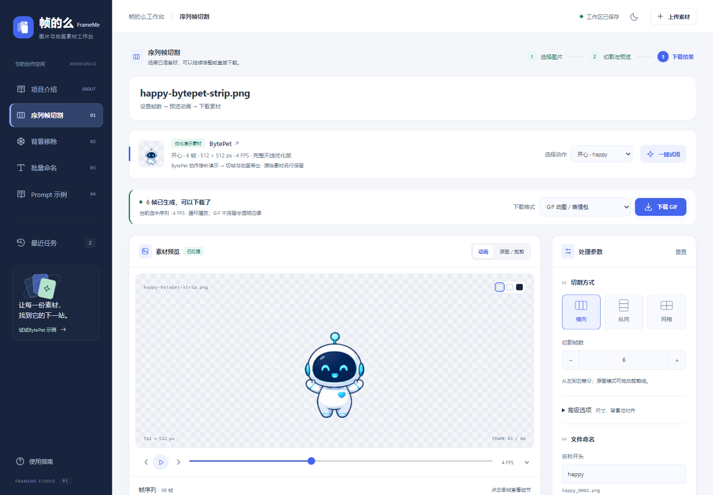
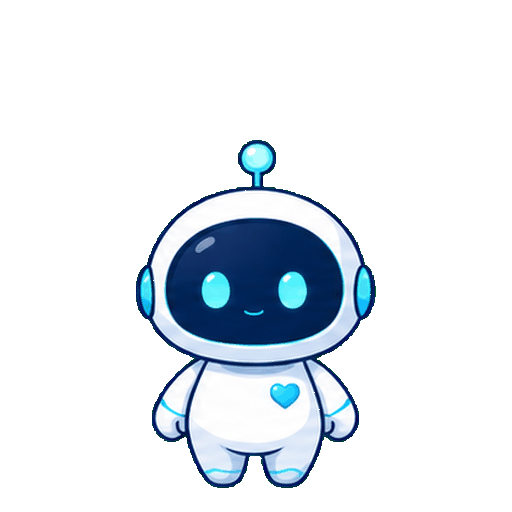

<div align="center">


# 帧的么 · FrameMe

### 一张图，连成一个完整动作。

**GIF 表情包 · 免费纯色去背景 · PNG 逐帧动画**

为 [**BytePet**](https://github.com/Li-Rui-Zhe/BytePet) 打磨角色动作时做的小工具，
现在也可以成为你的图片与动画素材工作台。

[](https://www.python.org/)
[](#-快速开始)
[](LICENSE)
[](https://github.com/Li-Rui-Zhe/BytePet)

[快速开始](#-快速开始) · [一张图怎么变成动画](#-一张图怎么变成动画) · [与 BytePet 一起用](#-与-bytepet-一起用) · [Prompt 指南](docs/PROMPT_GUIDE.md)

<picture>
  <source media="(prefers-color-scheme: dark)" srcset="docs/images/workbench-dark.png">
  
</picture>

</div>

## 👋 为什么有 FrameMe

做 BytePet 时，我需要把生成好的角色长条图切成每一帧，去掉背景，对齐大小，再整理成能被程序读取的动作目录。步骤不复杂，重复做起来却很费时间。

于是有了 FrameMe：把 **Prompt 示例、切帧、去底、手动修补、动画预览和下载** 放到一个工作台里。最初为桌宠准备素材，也适合做表情包、贴纸、游戏角色和产品动效。

> **FrameMe 准备每一帧，BytePet 让角色住进桌面。**
>
> [FrameMe 源码](https://github.com/Li-Rui-Zhe/FrameMe) · [BytePet 源码与下载](https://github.com/Li-Rui-Zhe/BytePet)

## 🎞️ 一张图怎么变成动画

这里的“一张图”，是 **一张包含六个连续动作瞬间的长条图**。

```text
角色参考图 + 六帧 Prompt
          ↓ 交给你使用的生图工具
1 张长条图：[第1帧][第2帧][第3帧][第4帧][第5帧][第6帧]
          ↓ 上传到 FrameMe，横向六等分
6 张 PNG → 免费去纯色背景 → 按顺序播放 → GIF / PNG 序列
```

比如一个打哈欠动作，可以画成「准备 → 张嘴 → 张大 → 停顿 → 闭嘴 → 恢复」。默认 Prompt 要求将六个瞬间画在 **同一张 3072 × 512 图片** 中，切开后得到六张 512 × 512 图片。

<div align="center">
  
  <br>
  <sub>一张六帧长条，切开后就是六张独立 PNG。</sub>
  <br><br>
  
  <br>
  <sub>同一组帧，导出为循环 GIF。图示使用 BytePet 开心动作的优化演示版。</sub>
</div>

**第一次用？** 打开工作台中的「Prompt 示例」，选择 Q 版、写实 / 国风或娜塔莎案例，直接复制。完整编辑项和详细指南按需展开，生成图片后再回来处理。

生图在你选择的生图工具里完成，FrameMe 负责素材处理。它不会直接从普通立绘自动补出动作；生成后需要检查帧数、构图与角色一致性。生图工具的能力和费用以其自身为准。

## 🧰 能做什么

| 你想做的事 | FrameMe 提供 |
| --- | --- |
| 做 GIF 表情包 | 横向 / 纵向 / 网格切帧，逐帧检查、调速预览、导出循环 GIF |
| 免费去背景 | 识别或取样纯色背景，调整容差和柔化，下载透明 PNG |
| 去底后再修一修 | 画笔擦除、恢复原图、撤销 / 重做、缩放和对比 |
| 做 PNG 逐帧动画 | 统一画布与主体位置，保留透明细节，下载 PNG ZIP 或精灵图 |
| 整理一批文件 | 统一前缀、连续编号、PNG 转换，打包下载 |
| 下次接着做 | 本机 SQLite 保存原图与参数，历史任务长期保留，可查看占用并手动删除 |

- **本机处理，无需注册**：Flask + Pillow 完成处理，不需要上传到第三方抠图服务。
- **选择格式直接下载**：GIF、当前 PNG、全部 PNG ZIP、分组 ZIP、精灵图 PNG。
- **按工作区保存**：不同工具与标签页分别保存，刷新后继续编辑。
- **有素材就能试**：内置 BytePet 动作与指定绿幕图，点击「一键试用」走完流程。

自动去底针对 **绿幕、白底等纯色背景**，不包含 AI 复杂场景分割。GIF 仅支持全透明 / 不透明；想保留半透明边缘，请用 PNG。

> **去背景小提示：** 背景有溢出或边缘残色时，请逐步调大颜色容差，每次重新处理后检查预览。不要一次调得太大，以免误删主体颜色，严重时可能导致整张图片透明；发现误删请调低容差后重试。细小彩边可配合“边缘净化 / 柔化”调整，局部残留可手动修补。

## 🚀 快速开始

需要 **Python 3.10+**。运行依赖只有 Flask 和 Pillow，不需要 Node.js 或前端构建。

```bash
git clone https://github.com/Li-Rui-Zhe/FrameMe.git
cd FrameMe
python -m venv .venv
```

激活环境：

```powershell
# Windows PowerShell
.venv\Scripts\Activate.ps1
```

```bash
# macOS / Linux
source .venv/bin/activate
```

安装并启动：

```bash
python -m pip install -r requirements.txt
python app.py
```

启动后打开 **[http://127.0.0.1:7860](http://127.0.0.1:7860)**。Windows 也提供 `install.bat` 和 `start.bat`，可直接使用系统 Python 安装与启动。

| 本地页面 | 用途 |
| --- | --- |
| `/` 或 `/editor` | 上传、处理、预览和下载 |
| `/prompts` | 复制六帧 Prompt，查看生图与处理指南 |
| `/about` | 功能介绍与六帧制作示意 |

1. **准备图片**：上传长条 / 网格素材，或先用 Prompt 与角色参考图生图。
2. **生成并检查**：设置切帧方式；需要时开启纯色去底，调整画布、裁剪与对齐。
3. **选格式下载**：GIF 用于分享，PNG 序列用于继续制作。点击「一键试用」也能先熟悉流程。

六帧 Prompt 的处理入口会在下一次上传时自动应用横向六帧、绿幕去底、512 px 和 4 FPS。独立图片模式可在详情里选择；它走 PNG 序列路线，批量命名不会将独立图片自动合成 GIF。

## 🤝 与 BytePet 一起用

[**BytePet**](https://github.com/Li-Rui-Zhe/BytePet) 是我的开源桌面 AI 伙伴项目，支持 PNG 序列帧角色资源。FrameMe 负责把动作素材准备好，BytePet 负责让这些动作在桌面上播放。

| 项目 | 做什么 |
| --- | --- |
| **FrameMe · 帧的么** | Prompt 模板、切帧、去底、修补、预览、命名和导出 |
| **[BytePet](https://github.com/Li-Rui-Zhe/BytePet)** | 使用动作资源，让角色成为桌面上的伙伴 |

以打哈欠为例：

```text
角色资源包/
├─ yawn/
│  ├─ yawn_0001.png
│  ├─ yawn_0002.png
│  └─ … yawn_0006.png
├─ calm/
└─ … 其余动作按 BytePet 当前资源包要求补齐
```

在 FrameMe 中按动作整理并导出，再按 BytePet 的资源包要求补齐目录后导入。**单个动作 ZIP 不是完整角色包。** 替换同一角色的动作时，需要保持各动作的画布尺寸一致。

→ [FrameMe 中的 BytePet 案例说明](docs/examples/bytepet.md) · [BytePet 当前资源包要求](https://github.com/Li-Rui-Zhe/BytePet#自定义角色资源包)

FrameMe 可以独立使用；你也可以把 PNG 或 GIF 带到自己的游戏、贴纸、动画项目中。

## 🔒 数据保存在你自己的电脑上

| 内容 | 默认位置 |
| --- | --- |
| 导入原图、工作区参数 | `.runtime/workspaces/workspaces.sqlite3` |
| 任务结果与原图副本 | `.runtime/jobs/` |
| 本机会话签名密钥 | `.runtime/session.key` |

结果默认长期保留，由你在「最近任务」中手动删除。身份绑定当前浏览器 Cookie；清除 Cookie 或更换浏览器不会自动认领旧数据。

`.runtime/`、原始素材库、上传 / 导出、数据库、日志、备份、私钥与本地配置都已列入 `.gitignore`。仓库中的图片是选定的公开演示素材和专门生成的展示图。

当前默认仅监听本机。公开部署需要正式 WSGI 服务、HTTPS 和配额管理，详见 [开发与部署说明](docs/DEVELOPMENT.md) 与 [安全说明](SECURITY.md)。

## 🛠️ 开发与贡献

```bash
python -m unittest discover -s tests -v
```

图像处理、API、会话隔离、SQLite 恢复、手动修补和长期保存均有后端回归；浏览器交互脚本位于 `tests/`，需要自行安装 Playwright。接口、限制和本地存储方式见开发文档。

- [Prompt 使用指南](docs/PROMPT_GUIDE.md)
- [开发、API 与存储](docs/DEVELOPMENT.md)
- [BytePet 案例与导入](docs/examples/bytepet.md)
- [素材来源与第三方说明](THIRD_PARTY_NOTICES.md)
- [提交问题或建议](https://github.com/Li-Rui-Zhe/FrameMe/issues)

欢迎带着脱敏后的复现步骤、示例素材或改进想法提交 Issue / PR。

## 📄 许可证与致谢

代码采用 **[MIT License](LICENSE)**。BytePet 原始素材保留其许可证与来源记录；开心优化演示版单独标注，详见 [素材说明](THIRD_PARTY_NOTICES.md)。

感谢你使用 FrameMe。也欢迎看看它最初服务的项目 [**BytePet**](https://github.com/Li-Rui-Zhe/BytePet)，把准备好的每一帧，变成桌面上的陪伴。
